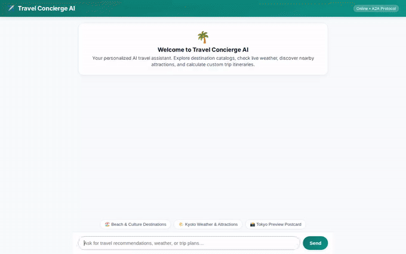

# Travel Concierge AI 🌴✈️

An intelligent, multi-modal AI travel concierge built with Google's Agent Development Kit (ADK). Travel Concierge AI helps users discover destinations, plan detailed itineraries, retrieve live weather and location data, generate visual previews and videos, and store persistent travel preferences across sessions.



---

## 🌟 Key Features & Architecture

Travel Concierge AI integrates advanced Google Cloud services and ADK tools to deliver a rich, interactive travel planning experience:

- **Cross-Session Memory Bank**: Integrated with **Vertex AI Memory Bank** (`VertexAiMemoryBankService` & `PreloadMemoryTool`) to store and remember user preferences, dietary restrictions, and travel history across sessions.
- **Itinerary Database Storage**: Connected to **Google Cloud Firestore** to save custom travel itineraries (`save_itinerary`) and recall stored trips (`get_user_itineraries`).
- **Generative Media & Cloud Storage**:
  - **Destination Photo Generation**: Uses Google's **Gemini Image Generation** (`generate_destination_image`) to create photorealistic destination previews.
  - **Destination Video Generation**: Uses Google's **Gemini Omni** model (`gemini-omni-flash-preview` via Vertex AI Interactions API in `global` region) to generate short destination promo videos (`generate_destination_video`).
  - **Public GCS Bucket**: Uploads generated images and videos to a public **Google Cloud Storage** bucket and returns public HTTPS URLs.
- **Location & Weather Intelligence**:
  - **Google Maps Geocoding & Places API**: Resolves coordinates (`geocode_address`) and finds nearby attractions, hotels, and restaurants (`find_nearby_places`).
  - **Live Weather API**: Retrieves real-time weather forecasts via Open-Meteo (`get_live_weather`).
- **A2UI Rich Card Rendering**: Implements Google ADK's **A2UI (Agent-to-User Interface)** protocol (`BasicCatalog` subset & `a2ui_callback`) to present destination cards, image galleries, and structured lists directly in the chat interface.
- **Custom Web Frontend**: Built with **FastAPI** and Vanilla CSS, proxying user messages to the agent over the A2A protocol with support for plain text and A2UI card components.

---

## 📋 Roadmap & Planned Features

The following capabilities were conceptualized in the project brief but are **planned, not yet implemented**:
- [ ] *Live Flight Booking Integration* `[Planned, not yet implemented]`
- [ ] *Payment Gateway & Reservation Checkout* `[Planned, not yet implemented]`
- [ ] *Real-Time Calendar Sync* `[Planned, not yet implemented]`

---

## 🚀 Setup & Local Execution

Follow these steps to run the agent backend and custom web frontend locally on your machine.

### Prerequisites

- Python 3.10+
- Google Cloud SDK (`gcloud`) authenticated with a GCP project having Vertex AI, Firestore, and Cloud Storage enabled.
- A Google Maps API key (for Geocoding & Places tools).

### 1. Clone & Set Up Environment

```bash
git clone https://github.com/<your-account>/travel-concierge-agent.git
cd travel-concierge-agent

python3 -m venv .venv
source .venv/bin/activate
pip install -r requirements.txt
```

### 2. Configure Environment Variables

Create or export the required environment variables:

```bash
export GOOGLE_CLOUD_PROJECT="<your-gcp-project-id>"
export GOOGLE_CLOUD_LOCATION="us-east1"
export GOOGLE_GENAI_USE_VERTEXAI="true"
export GOOGLE_MAPS_API_KEY="<your-google-maps-api-key>"
```

### 3. Deploy the Agent Backend

Deploy the ADK agent to Agent Runtime using `agents-cli`:

```bash
agents-cli deploy --update-env-vars "GOOGLE_MAPS_API_KEY=$GOOGLE_MAPS_API_KEY"
```

Deployment metadata will be saved to `deployment_metadata.json`, containing your `AGENT_ENGINE_RESOURCE_NAME`.

### 4. Run the Local Web Frontend

Launch the FastAPI chat proxy server:

```bash
export AGENT_ENGINE_RESOURCE_NAME="<paste-resource-name-from-deployment_metadata.json>"
export AGENT_DIRECTORY="app"
export PORT=8080

python main.py
```

Open your browser to access the local web interface.

---

## ☁️ Deploying to Cloud Run

To host the web frontend in production on Google Cloud Run:

```bash
gcloud run deploy travel-concierge-frontend \
  --source . \
  --region us-east1 \
  --allow-unauthenticated \
  --set-env-vars="AGENT_ENGINE_RESOURCE_NAME=$AGENT_ENGINE_RESOURCE_NAME,AGENT_DIRECTORY=$AGENT_DIRECTORY"
```

Grant the Cloud Run service account permission to invoke the agent runtime:

```bash
PROJECT_NUMBER=$(gcloud projects describe $GOOGLE_CLOUD_PROJECT --format="value(projectNumber)")

gcloud projects add-iam-policy-binding $GOOGLE_CLOUD_PROJECT \
  --member="serviceAccount:${PROJECT_NUMBER}-compute@developer.gserviceaccount.com" \
  --role="roles/aiplatform.user"
```

---

## 🛠️ Tech Stack

- **Agent Framework**: Google Agent Development Kit (ADK)
- **Models**: Gemini 2.5 Flash, Gemini Image Model, Gemini Omni Flash (`gemini-omni-flash-preview`)
- **Cloud Services**: Vertex AI Agent Engine, Vertex AI Memory Bank, Google Cloud Storage, Firestore, Cloud Run
- **Frontend & Proxy**: FastAPI, A2A Protocol, Vanilla CSS, Playwright
